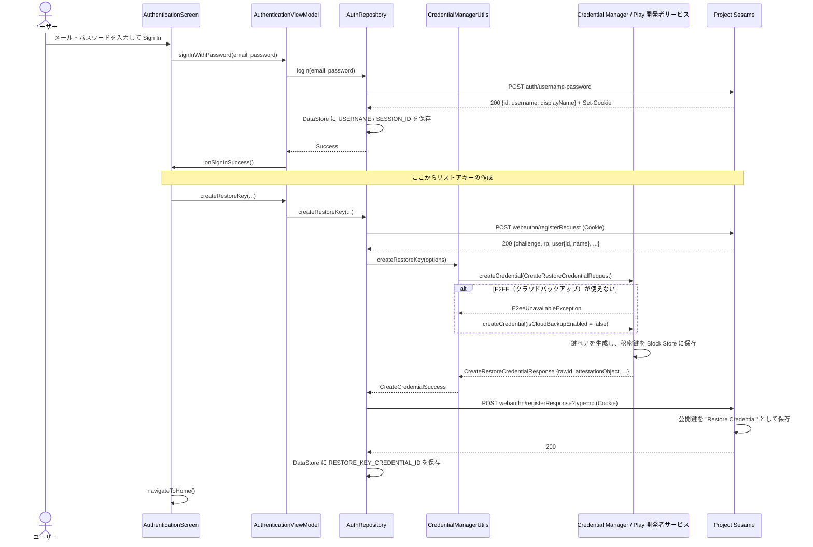
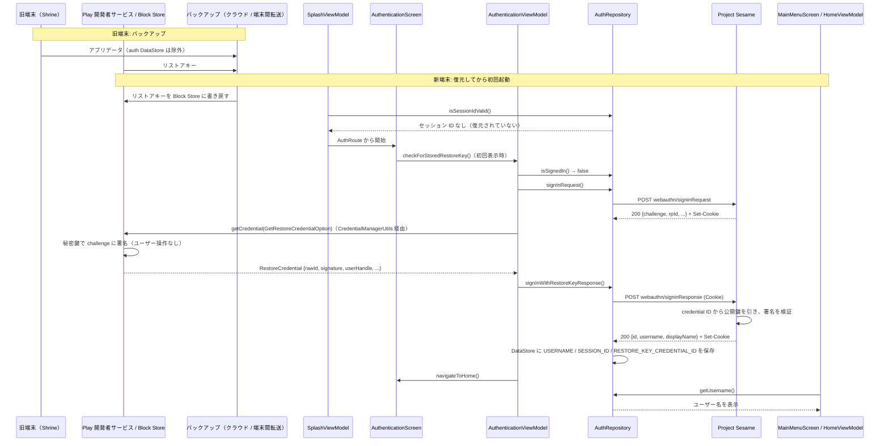

# Shrine: サインインと復元のシーケンス

Shrine（`:app`）のパスワードでのサインインと、Restore Credentials（ゼロタップログイン）の流れ。

## 1. サインイン（リストアキーの作成まで）

新規登録（`RegisterPasswordScreen` → `RegistrationViewModel.onPasswordRegister`）も、`auth/username-password` 以降は同じ流れ。

## 2. 復元（バックアップ → 新端末で自動ログイン）

## 補足

- 復元図の旧端末側の 2 本の矢印は、Android の仕組みを図にしたもの。Shrine のコードで行っている処理ではない。テストでは Android Studio の Backup App Data / Restore App Data（Device to Device）がこの役割を担う。手順は [README](../README.md) の「Testing zero-tap sign-in」。
- `auth` DataStore をバックアップから外している（`res/xml/data_extraction_rules.xml` / `backup_rules.xml`）ので、新端末では最初の `isSessionIdValid()` が失敗し、必ずログイン画面に入る。ここでリストアキーによるログインが動く。
- 新端末でリストアキーが見つからなかった場合は `getCredential` が失敗し、ログイン画面のままになる。
- サインアウト時は、端末のリストアキー（`clearCredentialState`）とサーバーの鍵（`webauthn/removeKey?credId=<RESTORE_KEY_CREDENTIAL_ID>`）の両方を削除する。
